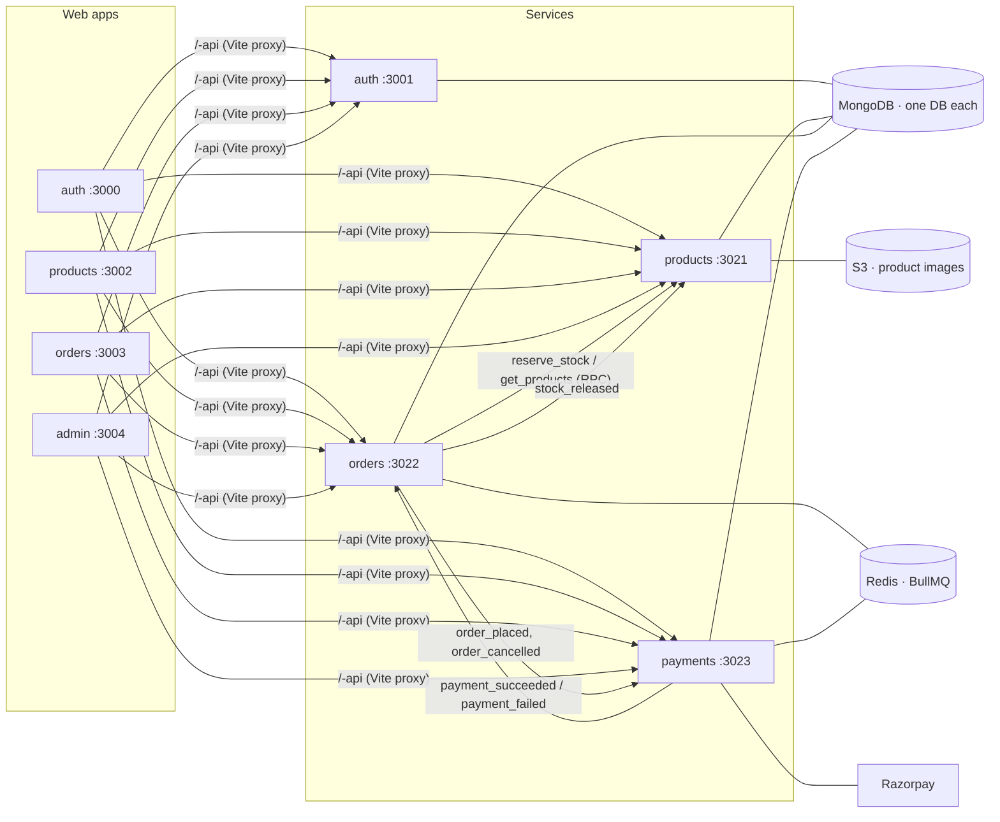

# Architecture

Turborepo + pnpm workspace. One NestJS monorepo (`apps/server`, four services), four React web apps
(`apps/client/*`) and shared packages (`packages/*`, built to `dist/` before any app uses them).

## Rules of the road

- **HTTP** is only for browsers. Each web app calls services through its Vite proxy (`/auth-api`, `/products-api`, …).
- **Services never call each other over HTTP**: RabbitMQ carries events and request-reply calls
  ([events and queues](events-and-queues.md)).
- **Long or retryable work** runs as BullMQ jobs on Redis (order placement, unpaid-order expiry, payment charges).
- **Auth**: the auth service signs HS256 JWTs; every service verifies them locally with the shared `JWT_SECRET`
  (`JwtAuthModule` from `backend-common`). `@Public()` opens a route, `@Roles("admin")` restricts one.
- **Data**: each service owns its MongoDB database and Prisma schema; no service reads another's data.

## Where things live

| Path | What |
| --- | --- |
| `apps/server/apps/<service>/` | One Nest service: `prisma/`, `prisma.config.ts`, `src/app.module.ts`, `src/main.ts`, feature folders |
| `apps/client/<app>/src/` | `routes/` (TanStack file routes), `pages/`, `components/`, `hooks/`, `services/` |
| `packages/backend-common` | Everything Nest services share (auth, decorators, RabbitMQ, queues, S3, Prisma module, bootstrap) |
| `packages/frontend-common` | API and auth clients, shared screens, payments (Razorpay Checkout), types mirroring the DTOs |
| `packages/oamui` | shadcn/ui components and the theme |
