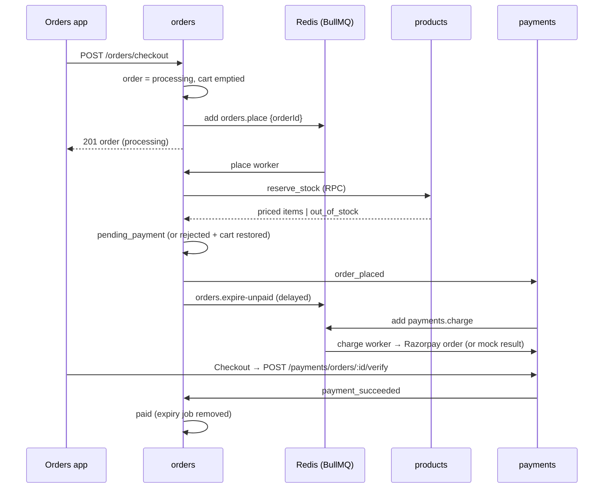

# Events and queues

Two transports, two jobs: **RabbitMQ** moves facts between services, **BullMQ on Redis** runs work that must survive
restarts, be retried or happen later.

## RabbitMQ messages

Names and payload types live once in `packages/backend-common/src/messaging/` (`PATTERNS`, `payloads.ts`). Each
service consumes its own queue (`RABBIT_MQ_<SERVICE>_QUEUE`); handlers carry `@AckMessage()`, which acks after the
handler finishes, even when it throws.

| Message | Kind | From → to | Payload |
| --- | --- | --- | --- |
| `get_products` | request-reply | orders → products | `{ ids }` → `ProductSummary[]` |
| `reserve_stock` | request-reply | orders → products | `{ items }` → `{ items }` priced, or `RpcException { message, code: "out_of_stock" \| "unavailable" }` |
| `stock_released` | event | orders → products | `{ orderId, items }` |
| `order_placed` | event | orders → payments | `{ orderId, userId, totalCents }` |
| `order_cancelled` | event | orders → payments | `{ orderId }` |
| `payment_succeeded` / `payment_failed` | event | payments → orders | `{ orderId, paymentId, reason? }` |

## BullMQ queues (Redis)

`createJobQueue(name, processor, { redisUrl })` from `backend-common`: three attempts with exponential backoff,
finished jobs removed. `jobId` makes a job unique, so a repeated event never queues the same work twice.

| Queue | Owner | Job | Does |
| --- | --- | --- | --- |
| `orders.place` | orders | `{ orderId }`, id = order id | Reserves stock, moves the order to `pending_payment`, emits `order_placed`, schedules expiry. Out of stock → `rejected` and the items go back to the cart; a fault is retried |
| `orders.expire-unpaid` | orders | `{ orderId }`, delayed `PAYMENT_TIMEOUT_MINUTES` | Cancels an order still unpaid: stock back, `order_cancelled` |
| `payments.charge` | payments | `OrderPlacedPayload`, id = order id | Opens a Razorpay order (or decides with the mock gateway); retried when Razorpay is unreachable |

## The order flow

The web app polls the order while it is `processing` or `pending_payment`.
